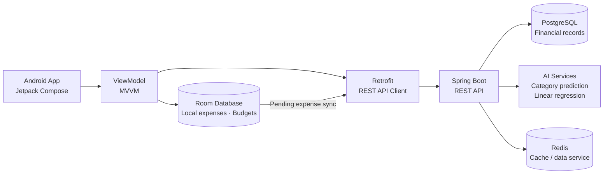

# 💰 MoneylyFinance

**An offline-first personal finance Android application: expense tracking → local persistence → backend synchronization → AI-powered category classification and spending prediction.**

A personal finance application that allows users to manage expenses, monitor monthly budgets and analyse spending patterns. The Android application uses Room for local persistence and communicates with a Java Spring Boot backend through REST APIs. The backend stores financial records in PostgreSQL and provides AI-powered expense category suggestions and spending predictions.

---

Demo

Dashboard UI

  
  <b>Figure 1.</b> MoneylyFinance dashboard

Expense management

  
  <b>Figure 2.</b> Expense tracking and management

Dashboard: monthly budget, total expenses and financial overview

Expense management: create, view, edit and delete expense records

AI category prediction: automated expense category suggestions

Spending prediction: forecast future spending from historical monthly expenses

Demo video: MoneylyFinance demo 
[Moneyly.zip](https://github.com/user-attachments/files/35230286/Moneyly.zip)

---

## Architecture

---

## Tech stack

| Area | Technologies |
|---|---|
| Android development | Kotlin, Android SDK, Jetpack Compose |
| Architecture | MVVM, Repository Pattern, Offline-First Architecture |
| Local database | Room, SQLite, Kotlin Coroutines, Flow |
| API integration | Retrofit, RESTful APIs, JSON, Gson |
| Backend | Java, Spring Boot, Gradle |
| Database | PostgreSQL, SQL |
| AI and predictive analytics | Expense classification, Linear Regression, Predictive Analytics |
| Infrastructure | Redis, Docker |
| Testing and development | Android Studio, IntelliJ IDEA, Postman, Git, GitHub |

---

## Concepts applied

**Android development**
- Declarative UI development with Jetpack Compose
- MVVM architecture and reactive UI state management
- Local persistence using Room Database
- Kotlin Coroutines and Flow for asynchronous operations

**Backend engineering**
- RESTful API design and CRUD operations
- Client-server communication using Retrofit
- Spring Boot service and controller layers
- PostgreSQL relational data persistence

**Data synchronization**
- Offline-first application architecture
- Local expense storage and pending-sync tracking
- Synchronization between Android and backend
- Expense creation, editing and deletion

**AI and predictive analytics**
- Automated expense category prediction
- Linear regression for next-month spending forecasts
- Historical monthly spending aggregation
- Backend integration for AI-powered features

**Software engineering**
- Separation of concerns between UI, business logic and data layers
- Docker-based service management
- Database migrations and schema versioning
- Git-based version control
