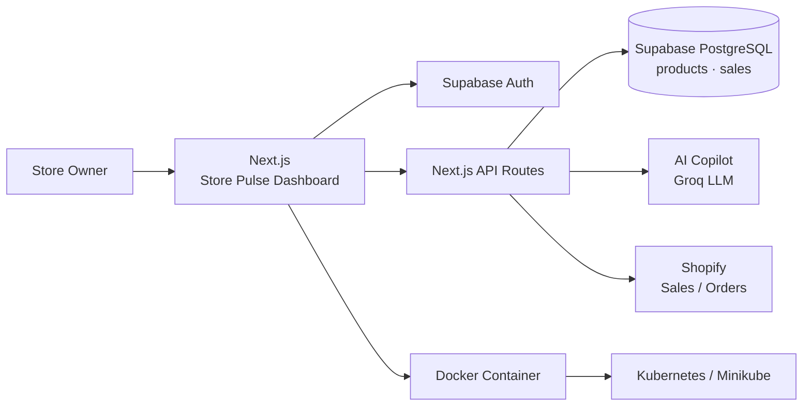

# 📦 Store Pulse

**An end-to-end inventory management platform: authenticated PostgreSQL inventory → sales tracking → Shopify integration → AI inventory copilot → Docker/Kubernetes deployment.**


Store Pulse is a full-stack inventory management dashboard for monitoring products, stock levels, sales activity and inventory health. Product and sales data are stored in Supabase PostgreSQL, with Supabase Auth and Row Level Security providing store-specific access control. The platform also integrates Shopify sales data and an LLM-powered copilot for natural-language inventory analysis and recommendations. The application is containerized with Docker and deployed locally through Kubernetes and Minikube.

---

## Demo

**Store Pulse Dashboard**

<p align="center">
  <br>
  <b>Figure 1.</b> Store Pulse inventory dashboard
</p>

- **Inventory:** product, SKU, category, price, stock and threshold information
- **Search / Filter:** find products by name, SKU or category
- **Stock monitoring:** identify products approaching or below their threshold
- **Sales:** view recent sales activity
- **AI Copilot:** ask natural-language questions about inventory and sales

**Demo video:** [Store Pulse demo](
)

[Moneyly.zip](https://github.com/user-attachments/files/35229202/Moneyly.zip)


---

## Architecture



---

## Tech stack

| Area | Technologies |
|---|---|
| Language | TypeScript |
| Frontend | Next.js, React, Tailwind CSS |
| Database | Supabase PostgreSQL |
| Authentication | Supabase Auth, `@supabase/ssr` |
| Security | PostgreSQL Row Level Security (RLS) |
| Backend | Next.js App Router, API Routes |
| Sales / Commerce | Shopify integration |
| LLM and AI | Groq API, AI inventory copilot |
| Containerization | Docker |
| Orchestration | Kubernetes, Minikube |
| Configuration | Environment variables, Kubernetes ConfigMaps and Secrets |

---

## Concepts applied

**Full-stack development**
- Next.js App Router with TypeScript
- Server and client components
- Responsive dashboard UI
- REST-style API routes
- Search and filtering

**Database engineering**
- PostgreSQL relational data modelling
- Products and sales tables
- Foreign-key relationships
- Database constraints and indexes
- Persistent inventory and sales records

**Authentication and security**
- Supabase authentication
- Server-side authentication with Supabase SSR
- Protected application routes
- PostgreSQL Row Level Security
- Store-specific data isolation using authenticated user IDs

**Inventory and sales**
- Stock-level monitoring
- Configurable inventory thresholds
- Low-stock identification
- Inventory value calculations
- Sales transaction tracking
- Manual and Shopify sales sources

**LLM engineering**
- Direct Groq LLM API integration
- Natural-language inventory analysis
- Structured inventory and sales context
- AI-generated inventory recommendations
- Read-only AI interaction with business data

**E-commerce integration**
- Shopify sales integration
- External order identifiers
- Shopify sales represented alongside internal sales
- Webhook-oriented integration architecture

**DevOps**
- Docker containerization
- Kubernetes Deployment and Service
- ConfigMaps and Secrets
- Minikube local Kubernetes environment

---

## Data

### Products

```text
products
├── id
├── store_id
├── name
├── sku
├── category
├── stock
├── threshold
├── price
├── created_at
└── updated_at
```

### Sales

```text
sales
├── id
├── store_id
├── product_id
├── quantity
├── unit_price
├── source
├── external_order_id
├── sold_at
└── created_at
```

The `store_id` associates records with the authenticated store, while `product_id` connects sales to inventory products. The `source` field distinguishes manually recorded sales from Shopify-originated sales.
